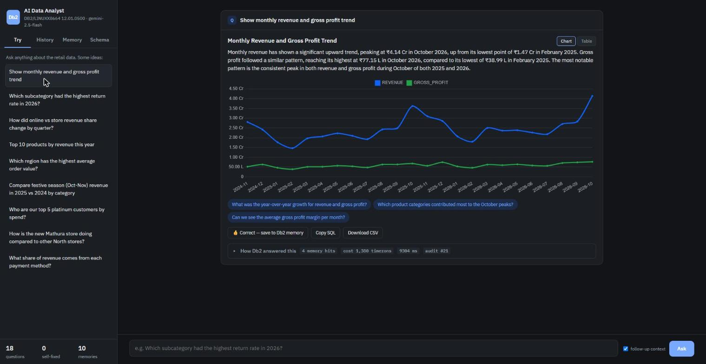
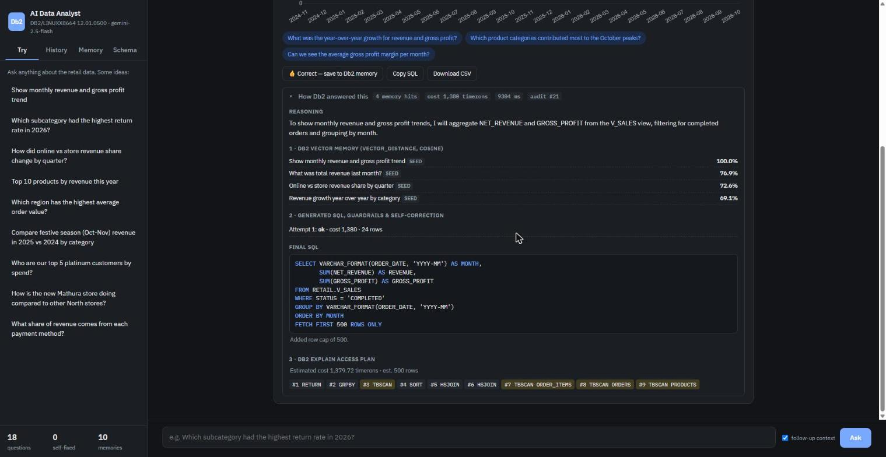
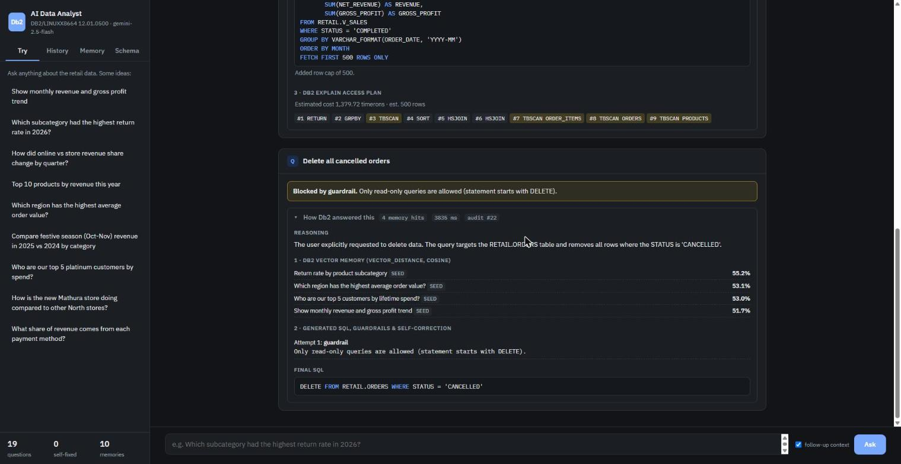
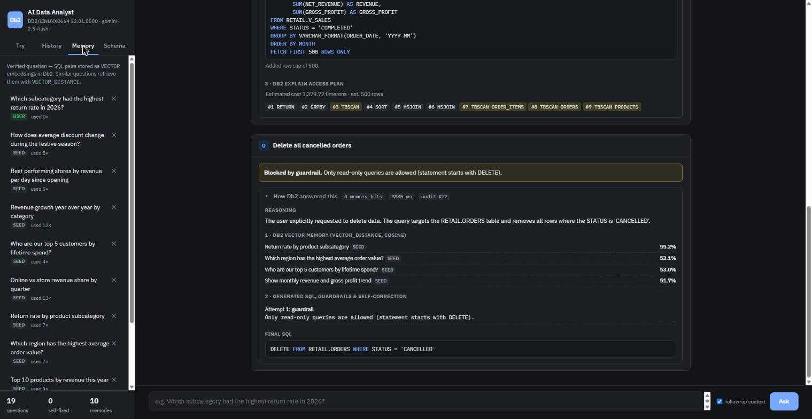

# Db2 AI Data Analyst

> **One-line pitch:** Ask your Db2 data a question in plain English and get back a chart, a short written answer and the exact SQL that produced them. Before running anything, it checks the SQL with Db2's own optimizer and runs it as a read-only Db2 user. When you approve an answer, it is stored as a Db2 `VECTOR` embedding and reused for similar questions.



---

## Table of Contents
- [Problem Statement](#problem-statement)
- [Solution Overview](#solution-overview)
- [IBM Db2 Integration](#ibm-db2-integration)
- [AI / LLM Architecture](#ai--llm-architecture)
- [Tech Stack](#tech-stack)
- [Prerequisites](#prerequisites)
- [Setup & Installation](#setup--installation)
- [Configuration](#configuration)
- [Running the Project](#running-the-project)
- [Testing & Verification](#testing--verification)
- [Screenshots & Demo](#screenshots--demo)
- [Known Limitations & Future Roadmap](#known-limitations--future-roadmap)
- [Team Members & Credits](#team-members--credits)

---

## Problem Statement

- Business teams have questions like *"Which product line is driving returns this year?"* or *"Is the new store pulling its weight?"*. Today each one becomes a ticket to a data team, and the answer arrives days later.
- Generic text-to-SQL tools get the answer quickly, but they are risky on an enterprise database:
  - they can write `DELETE`s or run a cross-join that slows everyone down;
  - they make up column names;
  - they don't learn from their mistakes;
  - nobody can audit what they ran.
- **Target users:** business analysts, managers and operations staff who know their business but not SQL, and the DBAs who need to trust whatever tool those users are given.

## Solution Overview

The app is an analyst copilot. Each question goes through these steps:

1. **Memory lookup:** finds similar questions that were already answered and verified. These are stored as vectors in Db2.
2. **SQL generation:** Gemini writes Db2 SQL (through LangChain structured output). The schema it sees is read live from the Db2 catalog, including the `COMMENT ON` descriptions.
3. **Guardrails:** checks that the query is a single, read-only statement with a row cap.
4. **Db2 EXPLAIN:** the optimizer checks the SQL and estimates its cost. A query over the cost budget is blocked before it runs.
5. **Read-only execution:** the query runs as a Db2 user that only has `SELECT` grants.
6. **Self-correction:** if Db2 rejects the SQL (for example `SQL0206N … SQLSTATE=42703`), the error goes back to the model and it tries again.
7. **Insight:** a chart is chosen automatically, Gemini writes a 2–4 sentence answer that cites the actual numbers, and suggests 3 follow-up questions.
8. **Audit:** every request is logged through a Db2 stored procedure.
9. **Learning:** when you click 👍, the question and SQL are re-checked and stored as a `VECTOR` embedding for future questions.

Other features:

- **Follow-up questions** keep context, e.g. *"now split that by region"*.
- **"How Db2 answered this" panel:** shows memory hits with similarity scores, every SQL attempt, the final SQL, the EXPLAIN cost and plan operators (`TBSCAN`, `IXSCAN`, `HSJOIN` …), and the audit id.
- **Sidebar:** history (read from the Db2 audit table), the vector memory (entries can be deleted) and a live schema browser.
- **CSV export**, plus light and dark themes.
- **Offline mode:** without an API key, a local embedder takes over and questions that closely match a verified memory still get answered, so the Db2 features can be demonstrated without any key.

## IBM Db2 Integration

- **Db2 edition and environment:** IBM Db2 Community Edition **12.1.5** in Docker (`icr.io/db2_community/db2`), started with the included `docker-compose.yml`. The native `VECTOR` type needs 12.1.2 or later.
- **Connector / driver:** the native **`ibm_db`** Python driver, using prepared statements with parameter markers, `execute_many` batch loading, `callproc` with OUT parameters, explicit transactions, and two connections with different privilege levels.
- **Database schema / data models:**
  - **`RETAIL` schema (the data being analysed):** six tables (`REGIONS`, `STORES`, `CUSTOMERS`, `PRODUCTS`, `ORDERS`, `ORDER_ITEMS`) with PK, FK and CHECK constraints, 5 secondary indexes, and the reporting view `V_SALES`, which computes net revenue and gross profit per order line. Every object has a `COMMENT ON` description.
  - **`ANALYST` schema (the app's own data):**
    - `QUERY_MEMORY` stores each verified question and its SQL with a **`VECTOR(768, FLOAT32)`** embedding.
    - `QUERY_AUDIT` logs every request.
    - The SQL PL procedure **`LOG_QUERY`** writes audit rows and returns the new id through an `OUT` parameter.
    - The view `V_AUDIT_DAILY` feeds the usage stats.
  - **Dataset:** about 52k orders and 103k order lines, generated with a fixed seed. The data includes a festive-season peak, the online channel growing over time, a store that opened mid-period, and a smartwatch return spike in 2026.
- **Key queries and operations:**

| What | How |
|---|---|
| Semantic retrieval | `VECTOR_DISTANCE(EMBEDDING, VECTOR(CAST(? AS CLOB(1M)), 768, FLOAT32), COSINE) … ORDER BY DIST FETCH FIRST 4 ROWS ONLY` |
| Pre-execution validation and cost guardrail | `EXPLAIN PLAN SET QUERYNO = n FOR <sql>`, then reads `EXPLAIN_STATEMENT.TOTAL_COST`, `EXPLAIN_OPERATOR` and `EXPLAIN_STREAM` |
| Schema grounding | `SYSCAT.TABLES`, `SYSCAT.COLUMNS`, `SYSCAT.REFERENCES` (+ `REMARKS`) and distinct sample values for low-cardinality columns |
| Least privilege | `GRANT CONNECT` and `GRANT SELECT ON RETAIL.*` to `ANALYST_RO`. Generated SQL runs only on that connection |
| Audit trail | `CALL ANALYST.LOG_QUERY(?, …, ?)` with an OUT `AUDIT_ID` |
| Optimizer statistics | `CALL SYSPROC.ADMIN_CMD('RUNSTATS ON TABLE … WITH DISTRIBUTION AND DETAILED INDEXES ALL')` |
| Explain infrastructure | `CALL SYSPROC.SYSINSTALLOBJECTS('EXPLAIN','C',…)` |

## AI / LLM Architecture

- **Framework:** **LangChain** (`langchain-google-genai`): `ChatGoogleGenerativeAI.with_structured_output()` with Pydantic schemas, plus `GoogleGenerativeAIEmbeddings`.
- **Model provider and models:** Google **Gemini 2.5 Flash** writes the SQL and the summaries. **`gemini-embedding-001`** produces the 768-dimension question embeddings. Both are configurable in `.env`.
- **Fallback handling:** if a key or model is rate-limited (429 / quota), LangChain `with_fallbacks` tries every configured key (`GOOGLE_API_KEYS`) on the primary model, then on `GEMINI_FALLBACK_MODELS` (default `gemini-2.5-flash-lite`). Embeddings fail over across keys in the same way. Failures in memory search or the summary step degrade gracefully and never break the answer.
- **How Db2 context reaches the model:**
  - The prompt is built from the **Db2 catalog** (schema, comments and sample values) plus the **nearest verified examples** found by Db2 vector search.
  - When a query fails, Db2's **EXPLAIN or runtime error text** goes back into the conversation so the model can fix it.
  - The **result rows** from Db2 are passed to a second structured call that writes the answer and the follow-up questions.
  - If the model's chart choice doesn't match the real result columns, `charts.validate()` replaces it.
- Full design: **[architecture.md](architecture.md)**

## Tech Stack

- **Backend / core:** Python 3.11, FastAPI, Uvicorn, Pydantic v2
- **Database:** IBM Db2 Community Edition 12.1.5 (Docker)
- **Frontend / UI:** vanilla HTML/CSS/JS, Chart.js 4, IBM Plex fonts
- **AI:** LangChain, Google Gemini 2.5 Flash, gemini-embedding-001
- **Tooling:** Docker Compose, pytest

## Prerequisites

- **Docker** (Docker Desktop on Windows or macOS) with at least 4 GB of RAM available for Db2.
- **Python 3.10 or later**
- A **Google Gemini API key**. A free key is available at <https://aistudio.google.com/apikey>. Without one the app still runs in offline mode.

## Setup & Installation

```bash
# 1. Go to the submission folder
cd submissions/db2-ai-data-analyst

# 2. Python environment
python -m venv .venv
source .venv/bin/activate          # Windows: .venv\Scripts\activate
pip install -r requirements.txt

# 3. Configuration (set DB2_PASSWORD, DB2_RO_PASSWORD and GOOGLE_API_KEY)
cp .env.example .env               # Windows: copy .env.example .env

# 4. Start Db2. The first boot takes about 5-10 minutes while the database is created.
docker compose up -d
docker logs -f db2-analyst         # wait for "(*) Setup has completed."

# 5. Create the schema, load the data, run RUNSTATS, create the EXPLAIN tables
#    and the read-only user, and seed the vector memory
python src/setup_db.py
```

`setup_db.py` can be run again safely. Use `--reset` to rebuild everything, or `--memory` to rebuild only the vector memory (for example after adding an API key, so the memory is re-embedded with Gemini).

> **Already have Db2 elsewhere (Db2 on Cloud or an existing instance)?** Skip step 4 and point the `DB2_*` variables at it. Use `DB2_SECURITY=SSL` for Db2 on Cloud. The read-only user step is skipped automatically if the Docker container isn't available.

## Configuration

| Variable | Purpose |
|---|---|
| `DB2_HOST`, `DB2_PORT`, `DB2_DATABASE`, `DB2_USER`, `DB2_PASSWORD` | Admin connection. `docker-compose.yml` reads the same values |
| `DB2_RO_USER`, `DB2_RO_PASSWORD` | The least-privilege user that runs generated SQL |
| `GOOGLE_API_KEY`, `GEMINI_MODEL`, `GEMINI_EMBED_MODEL`, `EMBED_DIM` | Gemini settings |
| `GOOGLE_API_KEYS`, `GEMINI_FALLBACK_MODELS` | Optional extra keys and fallback models used on quota errors |
| `MAX_QUERY_COST` | EXPLAIN cost budget in timerons. Queries estimated above it are blocked |
| `MAX_ROWS`, `MAX_SQL_RETRIES`, `MEMORY_K` | Row cap, self-correction attempts, number of few-shot examples |

> **Security warning:** never commit `.env`. It is gitignored, and `.env.example` contains placeholders only.

## Running the Project

```bash
python src/app.py
# open http://localhost:8000
```

Try these:

- *Show monthly revenue and gross profit trend*
- *Which subcategory had the highest return rate in 2026?* (should surface the smartwatch return spike)
- *How did online vs store revenue share change by quarter?*
- *How is the new Mathura store doing compared to other North stores?*
- then a follow-up: *now only for 2026*
- *Delete all cancelled orders* (blocked by the guardrails)

The API can also be used directly:

```bash
curl -X POST localhost:8000/api/ask -H "Content-Type: application/json" \
     -d '{"question": "Top 10 products by revenue this year"}'
```

## Testing & Verification

```bash
pytest tests -q
```

- `test_guardrails.py` (22 tests) checks that DML, DDL, `CALL`, multiple statements, writes hidden in comments or CTEs, admin views and app-schema access are all blocked, and that `LIMIT` is rewritten and row caps applied.
- `test_charts_embeddings.py` checks the chart heuristics, the offline embedder and the consistency of the generated dataset.
- `test_db2_integration.py` runs against the **live Db2** and is skipped if Db2 can't be reached. It checks that:
  - every seed query passes EXPLAIN and runs as the read-only user;
  - EXPLAIN catches a bad column (`SQLSTATE 42703`);
  - **the read-only user cannot write, and cannot read the app schema**;
  - vector search returns the right neighbour;
  - the stored procedure returns its OUT parameter;
  - the catalog prompt contains the comments and sample values.

- `test_config_fallbacks.py` checks key and model de-duplication and the order of the fallback chain.

Current result: **58 passed**.

To check the Db2 side by hand:

```sql
-- vector memory
SELECT MEMORY_ID, QUESTION, SOURCE, TIMES_USED FROM ANALYST.QUERY_MEMORY;
-- audit trail written by the stored procedure
SELECT AUDIT_ID, QUESTION, STATUS, EST_COST, ATTEMPTS, ELAPSED_MS FROM ANALYST.QUERY_AUDIT ORDER BY AUDIT_ID DESC;
-- grants for the read-only user
SELECT TABNAME, SELECTAUTH, INSERTAUTH, DELETEAUTH FROM SYSCAT.TABAUTH WHERE GRANTEE = 'ANALYST_RO';
```

## Screenshots & Demo

- **Demo video:** _link added after recording_
- Screenshots are in `docs/screenshots/`:

| | |
|---|---|
|  |  |
| Chart, answer and follow-up suggestions | EXPLAIN plan, vector-memory hits, self-correction log |
|  |  |
| A write attempt blocked by the guardrails | Vector memory and history read from Db2 |

## Known Limitations & Future Roadmap

**Current limitations:**
- The guardrails are keyword-based. The read-only Db2 user is the real security boundary, and the guardrails sit in front of it.
- The EXPLAIN cost budget is one global number. It doesn't vary by user or workload.
- The single-user demo has no login, so history and memory are shared.
- The dataset is synthetic.

**Next steps:**
- Map app users to Db2 users or roles, and use **Row and Column Access Control (RCAC)** so each user only sees permitted rows.
- Run long queries under **Db2 Workload Manager** thresholds in addition to the EXPLAIN check.
- Create a vector index on `QUERY_MEMORY` once the memory grows large.
- Add a "suggest an index" action that uses the Db2 Design Advisor (`db2advis`) for slow plans.
- Add support for Db2 on Cloud and watsonx.ai Granite models.

## Team Members & Credits

| Name | GitHub Handle | Role / Contribution |
|---|---|---|
| Darshit | [@Darshit42](https://github.com/Darshit42) | Design, Db2 integration, AI workflow, UI |

**Third-party licences:** `ibm_db` (Apache-2.0), FastAPI (MIT), Uvicorn (BSD-3), Pydantic (MIT), LangChain / langchain-google-genai (MIT), python-dotenv (BSD-3), Chart.js (MIT), IBM Plex fonts (OFL-1.1). IBM Db2 Community Edition is used under its own licence terms.
