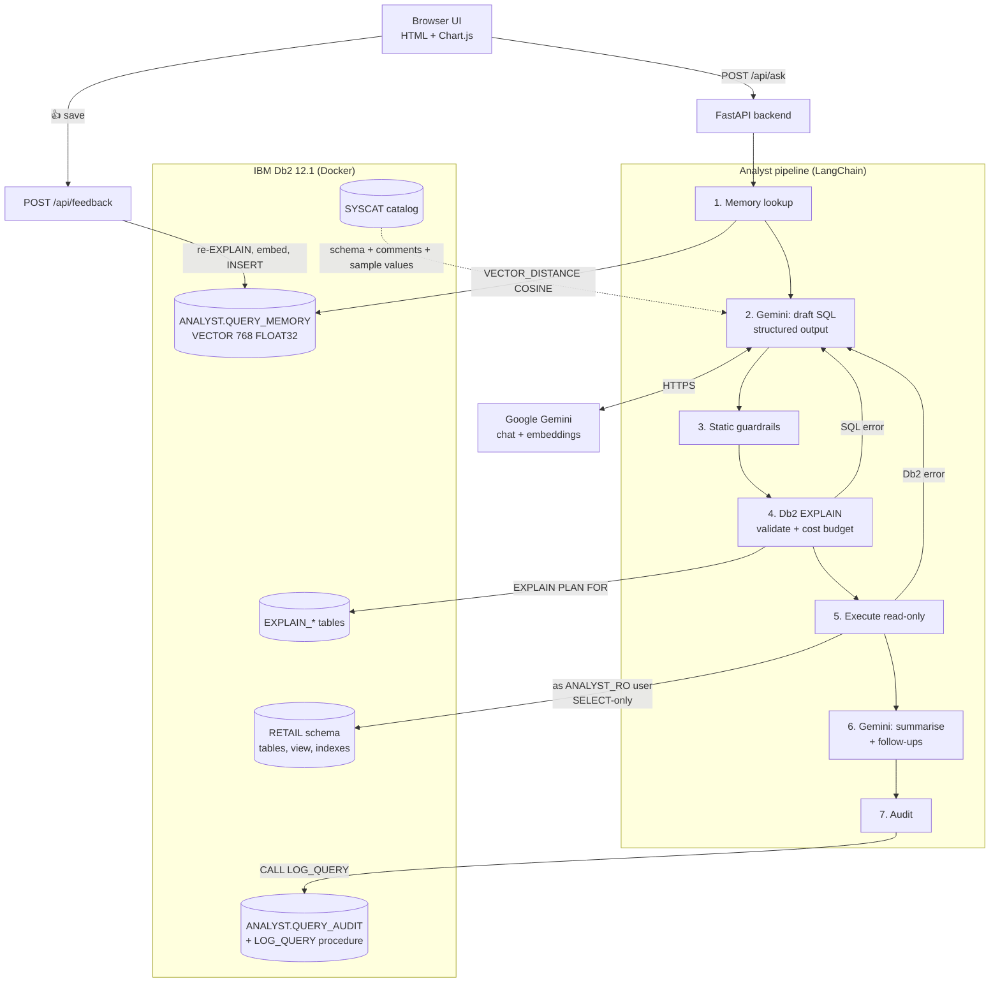

# System Architecture — Db2 AI Data Analyst

## Overview

A business user types a question in plain English. The backend turns it into a **validated, cost-checked, read-only Db2 SQL query**, runs it, and returns a chart, a table and a short written answer. Every step is shown in the UI.

IBM Db2 has four jobs in this system, not one:

| Role | Db2 feature |
|---|---|
| **System of record:** the retail data being analysed | Relational tables, PK/FK constraints, CHECK constraints, indexes, a reporting view, `RUNSTATS` statistics |
| **Semantic memory:** verified question→SQL pairs used as few-shot examples | Native `VECTOR(768, FLOAT32)` column with `VECTOR_DISTANCE(..., COSINE)` nearest-neighbour search |
| **Safety layer:** checks a query before it runs | `EXPLAIN PLAN` and the explain tables (cost estimate, cardinality, access-plan operators); a separate Db2 user that holds only `SELECT` grants |
| **Audit and analytics:** every question logged | SQL PL stored procedure `ANALYST.LOG_QUERY` with an `OUT` parameter, audit table and a daily-usage view |

The LLM (Gemini via LangChain) is used for two narrow tasks: writing SQL and summarising results. Db2 does the other work: it supplies context, checks queries, runs them, and remembers what worked.

---

## Architecture Diagram



---

## Component Breakdown

1. **User Interface (`src/static/`)**
   - One-page app: question box, answer cards with a chart or table, follow-up suggestion chips, CSV export.
   - A **"How Db2 answered this"** panel on each card shows the memory hits and their similarity scores, every SQL attempt (including self-corrections), the final SQL, the EXPLAIN cost and the plan operators (`TBSCAN` and `IXSCAN` highlighted), and the audit id.
   - The sidebar has example questions, history (read from the Db2 audit table), the vector memory (each entry can be deleted) and a schema browser (read from the Db2 catalog).

2. **Backend (`src/app.py`, FastAPI)**
   - `POST /api/ask` runs the pipeline. It accepts an optional history of earlier questions and SQL so that follow-up questions work.
   - `POST /api/feedback` handles 👍: the server re-validates the SQL with EXPLAIN, then stores it in vector memory.
   - `POST /api/explain` returns the access plan for any SQL that passes the guardrails.
   - `GET /api/schema`, `/api/memory`, `/api/history`, `/api/stats` and `/api/health` serve the sidebar.

3. **Database layer (`src/analyst/db.py`, `explain.py`, `catalog.py`, `memory.py`)**
   - Uses the native `ibm_db` driver directly, with parameter markers for all values.
   - Keeps two connections: the **admin** connection (EXPLAIN, memory, audit) and the **read-only** connection (`DB2_RO_USER`), which runs the generated SQL.
   - `Catalog` builds the schema prompt from `SYSCAT.TABLES`, `SYSCAT.COLUMNS` and `SYSCAT.REFERENCES`, including the `COMMENT ON` remarks. It also adds distinct sample values for low-cardinality columns so the model writes `'COMPLETED'` and not `'Completed'`.
   - `explain()` runs `EXPLAIN PLAN SET QUERYNO = n FOR <sql>`, then reads `EXPLAIN_STATEMENT` (total cost), `EXPLAIN_OPERATOR` and `EXPLAIN_STREAM` (operators, the objects they touch, estimated rows).

4. **AI orchestration (`src/analyst/agent.py`)**
   - LangChain `ChatGoogleGenerativeAI` with `.with_structured_output()` and Pydantic schemas (`SqlDraft`, `Insight`), so the output can be parsed every time.
   - Prompt contents: Db2 dialect rules, today's date and the date range of the data, the catalog-derived schema, the top-k memory examples and up to 3 earlier turns.
   - **Self-correction loop:** if EXPLAIN or execution fails, the Db2 message (for example `SQL0206N "X" is not valid ... SQLSTATE=42703`) goes back to the model, up to `MAX_SQL_RETRIES` times. A query blocked by the cost budget is not retried; the user is asked to narrow the question.
   - Chart choice: the model proposes a chart spec. `charts.validate()` checks it against the real result columns and falls back to a heuristic when it doesn't match.
   - **Offline mode:** with no API key, embeddings fall back to a local hashed n-gram embedder. A question that closely matches a verified memory (similarity ≥ 0.8) is answered with the stored SQL, so the Db2 side of the demo still works.

---

## Data Flow

1. **Input:** the user submits a question, optionally with the earlier turns as context.
2. **Memory retrieval:** the question is embedded with `gemini-embedding-001` (768 dimensions), then
   ```sql
   SELECT MEMORY_ID, QUESTION, SQL_TEXT, SOURCE,
          VECTOR_DISTANCE(EMBEDDING, VECTOR(CAST(? AS CLOB(1M)), 768, FLOAT32), COSINE) AS DIST
   FROM ANALYST.QUERY_MEMORY ORDER BY DIST FETCH FIRST 4 ROWS ONLY
   ```
   Hits within the distance threshold become few-shot examples, and their `TIMES_USED` count goes up by one.
3. **Generation:** Gemini returns `{reasoning, sql, title, chart}`.
4. **Guardrails** (`guardrails.py`, no database access):
   - single statement only
   - must start with `SELECT`/`WITH`/`VALUES`
   - no DML/DDL/`CALL` keywords, checked outside string literals and comments
   - no `SYSIBMADM`, `SYSPROC` or app schema
   - no `FOR UPDATE`
   - `LIMIT n` is rewritten to `FETCH FIRST n ROWS ONLY`
   - a row cap is added or tightened
5. **EXPLAIN:** Db2 compiles the query. A semantic error at this stage costs nothing and starts the self-correction loop. A plan whose cost is over `MAX_QUERY_COST` timerons is **blocked**.
6. **Execution:** the query runs as `ANALYST_RO`. Even if the earlier checks missed something, Db2 refuses any write and any read outside `RETAIL`.
7. **Summary:** Gemini writes a 2–4 sentence answer that cites numbers from the rows, plus 3 follow-up questions.
8. **Persistence:** `CALL ANALYST.LOG_QUERY(...)` writes the question, final SQL, status, cost, row count, latency, attempt count and a JSON trace, and returns the new `AUDIT_ID` through an `OUT` parameter.
9. **Learning:** when the user clicks 👍, the question→SQL pair is re-checked and inserted into `QUERY_MEMORY` as a vector. The next similar question retrieves it.

---

## IBM Db2 Schema & Storage Design

```sql
-- Business data (RETAIL)
REGIONS(REGION_ID PK, REGION_NAME, COUNTRY)
STORES(STORE_ID PK, STORE_NAME, CITY, REGION_ID FK, CHANNEL CHECK IN ('STORE','ONLINE'), OPENED_ON)
CUSTOMERS(CUSTOMER_ID PK, FULL_NAME, EMAIL, CITY, SEGMENT CHECK, LOYALTY_TIER CHECK, SIGNUP_DATE)
PRODUCTS(PRODUCT_ID PK, SKU UNIQUE, PRODUCT_NAME, CATEGORY, SUBCATEGORY, BRAND, UNIT_COST, LIST_PRICE)
ORDERS(ORDER_ID PK, CUSTOMER_ID FK, STORE_ID FK, ORDER_DATE, STATUS CHECK, PAYMENT, SHIPPING_FEE)
ORDER_ITEMS(ORDER_ID FK, LINE_NO, PRODUCT_ID FK, QUANTITY CHECK > 0, UNIT_PRICE, DISCOUNT_PCT, PK(ORDER_ID, LINE_NO))

-- Indexes chosen for the typical analytical predicates / joins
IX_ORDERS_DATE (ORDER_DATE, STATUS), IX_ORDERS_CUSTOMER, IX_ORDERS_STORE,
IX_ITEMS_PRODUCT, IX_PRODUCTS_CAT (CATEGORY, SUBCATEGORY)

-- Reporting view: one row per order line with NET_REVENUE and GROSS_PROFIT precomputed
VIEW V_SALES

-- Application data (ANALYST)
CREATE TABLE ANALYST.QUERY_MEMORY (
    MEMORY_ID  INTEGER GENERATED ALWAYS AS IDENTITY PRIMARY KEY,
    QUESTION   VARCHAR(1000) NOT NULL,
    SQL_TEXT   CLOB(64K) NOT NULL,
    EMBEDDING  VECTOR(768, FLOAT32) NOT NULL,
    SOURCE     VARCHAR(10) CHECK (SOURCE IN ('SEED','USER')),
    TIMES_USED INTEGER DEFAULT 0,
    CREATED_AT TIMESTAMP DEFAULT CURRENT TIMESTAMP
);
CREATE TABLE ANALYST.QUERY_AUDIT (... STATUS, EST_COST, ROW_COUNT, ELAPSED_MS, ATTEMPTS, ERROR_TEXT, DETAILS CLOB);
CREATE PROCEDURE ANALYST.LOG_QUERY (IN ..., OUT P_AUDIT_ID BIGINT) LANGUAGE SQL MODIFIES SQL DATA;
CREATE VIEW ANALYST.V_AUDIT_DAILY AS ... GROUP BY DATE(ASKED_AT);
```

Every table and important column has a `COMMENT ON` remark (for example *"Revenue should normally only count STATUS = COMPLETED"*). The prompt builder reads these from the catalog, so documenting the schema in Db2 directly improves the SQL the model writes.

The full DDL is in [`src/analyst/sql/schema.sql`](src/analyst/sql/schema.sql).

### Dataset

`src/analyst/seed_data.py` generates the dataset with a fixed seed, so every run produces the same data:

- 3,000 customers, 21 stores (20 physical and 1 online), about 210 products
- about 52,000 orders and 103,000 order lines, from Nov 2024 to Oct 2026

Patterns built into the data for the analyst to find:

- a festive-season peak in October and November
- the online channel growing from 28% to 50% of orders
- a store in Mathura that opened mid-period
- heavier discounting in fashion
- a spike in smartwatch returns from March to July 2026

The data is loaded with `ibm_db.execute_many` in 2,000-row batches inside transactions, then `RUNSTATS ... WITH DISTRIBUTION AND DETAILED INDEXES ALL` runs so that EXPLAIN costs are realistic.

---

## Security & Secrets Management

- **Least privilege in Db2:** generated SQL runs as `ANALYST_RO`. This user has `CONNECT` and `SELECT` on `RETAIL.*` and nothing on `ANALYST.*`. `setup_db.py` creates the OS user inside the container and issues the `GRANT`s.
- **Defence in depth:** static guardrails, then the EXPLAIN cost budget, then Db2 privileges, then a row cap.
- **No string concatenation of user values.** Every value goes in through a parameter marker. The only SQL text that isn't parameterised is the generated query, and it goes through the checks above first.
- **Secrets:** all credentials and API keys come from environment variables (`.env`, which is gitignored). `.env.example` holds placeholders only, and `docker-compose.yml` reads the Db2 password from `.env`.
